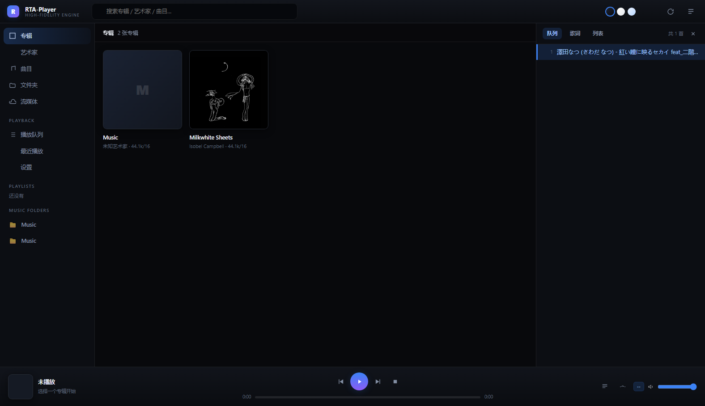
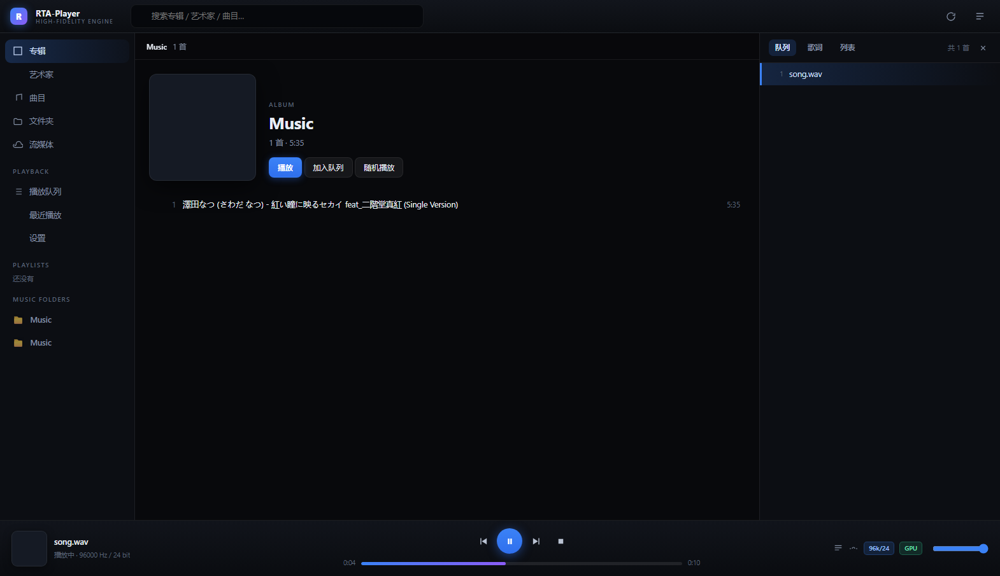
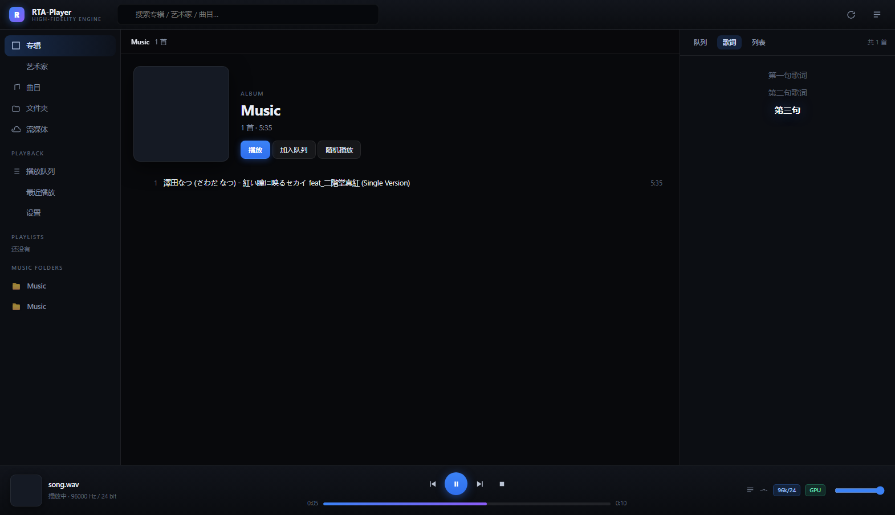
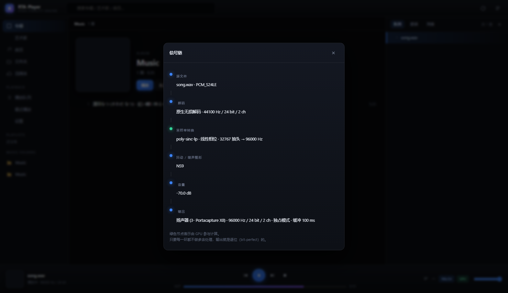
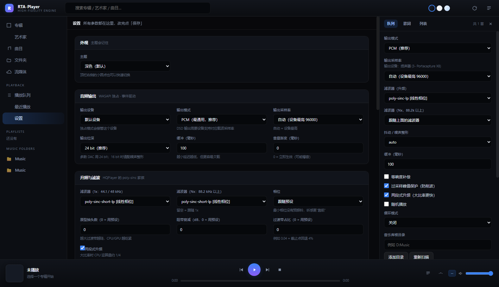
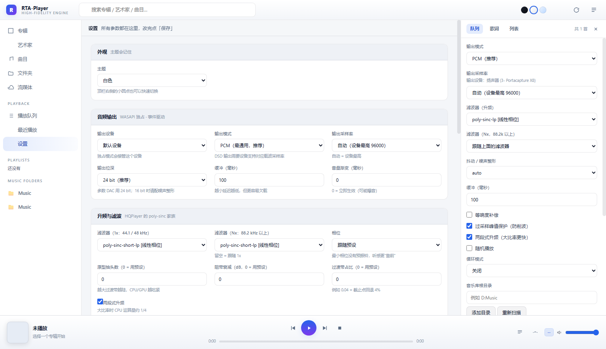

# RLPlayer

**Windows 上的高保真播放引擎 + 播放器**（HQPlayer 同类）。核心目标只有一个：**不计代价提升本地播放音质**，并且把每一步都变成可测量的数字。

- 输出链路完全自研：升频 → 抖动/噪声整形 → SDM/DSD 调制 → 卷积 → 20 段 PEQ → WASAPI 独占 / ASIO / UPnP / 网络端点
- **不追求"听起来更好"，追求"能测出来好"**：升频阻带 −189 dB、DSD 源抽取 THD+N 99.2 dB、网络传输端到端逐位相同
- 内置 WebView2 界面（**真正无边框**、托盘常驻），也可全部用 CLI 驱动
- 单包自包含：内置 ffmpeg/ffprobe、GPU 内核、WebView2 运行时，用户机上**不需要装任何运行库**

> 当前版本 **1.3.15**（2026-10-24）。最新事实、逐轮实测数字与已知限制以 [STATUS.md](STATUS.md) 为准。



---

## 最近更新（1.3.15）

| 项 | 内容 |
|---|---|
| 窗口 | **四边可拖拽拉伸**（页面发起 resize；WebView2 子窗口跨进程，原生 hit-test 拿不到鼠标） |
| GPU | `/api/status` 拆成 `gpu`（可用）/ `gpuUsed`（本次真的参与）/ `gpuResample` / `gpuConv`；修掉"一首走过 GPU 后所有曲目都亮"的复位 bug |
| AI 资料 | 进单曲页/专辑页**自动整理**（不用再点）；专辑页并发 ≤2 后台预取全部曲目；检索 knowledge 与 search+fetch 并行（受控 A/B −46%） |
| 页面 | 艺术家页不再整页空白（先渲染基础页）；专辑资料不再贴边；「切到 bit-perfect 直通」挪到输出后端右侧 |
| PEQ | 旁路语义写清 + 常驻状态行（已旁路 / 生效·全 0 dB / 生效·有非 0 dB 段） |
| 音频 | 独占缓冲尊重设置（1.3.14）：删除 20 ms 封顶 + L1/L2 自适应回退 + 学习缓存；STAT 增 `dry/per/bf` |

1.3.14：**四边白框真因**（WebView2 创建时内缩 5px）、歌词跟随重写、PEQ 20 段对齐与 HIFI 化、N300 欠载修复。

---

## 特性

### DSP 链路

| 能力 | 说明 |
|---|---|
| **多相 sinc 升频** | 任意有理比率；阻带 **−189 dB**，通带纹波 **0.0000 dB** |
| **滤波器家族** | 16 个预设 + 倒谱法最小相位、混合相位；可指定抽头数 |
| **抖动 / 噪声整形** | 10 项：NS1/NS4/NS5/NS9/LNS15 + RPDF/TPDF/Gauss1/shaped |
| **SDM 调制器** | DSD5 / DSD7、多电平 AHM 风格；1-bit 带内 SNR 86.2 dB，8-bit 118.8 dB |
| **DSD 原生读取** | DSF/DFF 直接读；抽取器 FIR/IIR/CIC；**DirectSDM 逐位直通** |
| **卷积引擎** | 零延迟均匀分块 FFT，**支持 GPU**（IR 262144 抽头 / 1 秒音频 = 2.0 ms） |
| **20 段参数均衡 PEQ** | RBJ 双二阶（PK/LS/HS）、1/3 倍频程、曲线可拖拽节点、自动前级（防削波）、预设 |
| **Matrix / EQ** | 声道路由 + 双二阶 IIR EQ + 延迟插件 + REW/AutoEq 文本解析 + OPRA 耳机预设 |
| **多声道** | 5.1 / 7.1（WAVEFORMATEXTENSIBLE 声道掩码）+ 每声道增益微调 |
| **保护** | 过采样峰值检测（ISP）自动预衰减、音量渐变、响度补偿；满幅/瞬态/恢复都有回归测试 |

### 输出后端

| 后端 | 用途 |
|---|---|
| **WASAPI 独占** | bit-perfect 直通；自动协商采样率/位深，设备不支持时**如实报错不静默替换**；缓冲尊重用户设置（20–500 ms，失败自适应回退） |
| **WASAPI 共享** | 独占不可用时的兜底（非 bit-perfect，会明确告知） |
| **ASIO** | 低延迟专业声卡（驱动崩溃用子进程预检隔离） |
| **UPnP / DLNA** | 一键推送到局域网渲染器（单曲页 / 流媒体页 / 底栏三处同源） |
| **NAA / RTANet** | 两机网络音频：**RTANet 端到端逐位相同** + 时钟漂移检测；标准 NAA 只做发现 |
| **Null** | 离线/自动化测试，不开任何设备 |

### 界面

WebView2 内嵌、**完全无边框**（无系统标题栏/白框，四边可拉伸，6px 边缘热区）、托盘常驻：
专辑网格 / 艺术家 / 曲目 / 文件夹 / 流媒体 / 单曲整页（歌词跟随 + 资料抽屉 + 推送）/ 播放队列 / 设置页（输出·PCM·SDM·高级·EQ·元数据·流媒体·诊断）。
三套主题（深 / 浅 / 浅蓝），标题栏与窗口边随主题即时切换。

### 元数据与 AI

- 播放时自动补全标签/封面/歌词：QQ 音乐 / 网易云 / iTunes / lrclib / Discogs；
- DeepSeek 负责疑难文件名解析、歧义裁决与"资料整理"（**防幻觉**：无来源时标注"AI 整理"，有来源时强制引用）；
- 实体级缓存（person/release/track），命中即秒回；单曲页与艺术家页**共用同一份 person 缓存**；
- 可选写回文件标签（`rtatag`），失败不动原文件。

---

## 界面

| | |
|---|---|
|  |  |
|  |  |
|  |  |

---

## 快速开始

### 直接用发布包

1. 解压 `RLPlayer-<版本>-win64.zip`（约 371 MB，解压后约 885 MB）
2. 双击 `RLPlayer.exe`
3. 托盘图标右键：打开界面 / 复制地址 / 允许局域网访问 / 退出

无需安装 VC++ 运行库，无需安装 ROCm，无需单独装 ffmpeg。

### 用 CLI

```powershell
# 列出音频端点 + 独占模式支持的采样率/位深矩阵
tools\wasapi_probe.exe

# 生成测试音（默认 −60 dBFS，不可闻；铁律：绝不擅自放可听声音）
tools\rtaplay.exe --gen tone.wav 5 44100 24

# bit-perfect 直通
tools\rtaplay.exe music.flac

# 升频 + 噪声整形
tools\rtaplay.exe music.flac --rate 705600 --taps 262144 --shaper NS9 --bits 24

# 房间校正（卷积）+ 耳机 EQ + 音量
tools\rtaplay.exe music.flac --ir room.wav --eq autoeq.txt --volume -6 --gpu

# 只跑管线不开设备（验证链路首选）
tools\rtaplay.exe music.flac --rate 705600 --analyze
```

---

## 从源码构建

### 前置

| 依赖 | 说明 |
|---|---|
| CMake ≥ 3.20 + Ninja | 构建系统 |
| clang++ / lld-link / llvm-rc | **ROCm 自带的那套**即可（无需 Visual Studio，但需要 Windows SDK 的 rc/库） |
| Windows SDK | 系统 API / WASAPI / ASIO 头 |
| WebView2 SDK | 已在 `third_party/webview2` 内置头文件 |

### 构建

```powershell
cmake -G Ninja -S . -B build -DCMAKE_BUILD_TYPE=Release `
      -DCMAKE_CXX_COMPILER="C:/Program Files/AMD/ROCm/7.2/bin/clang++.exe" `
      -DCMAKE_AR="C:/Program Files/AMD/ROCm/7.2/bin/llvm-ar.exe" `
      -DCMAKE_LINKER="C:/Program Files/AMD/ROCm/7.2/bin/lld-link.exe" `
      -DCMAKE_RC_COMPILER="C:/Program Files/AMD/ROCm/7.2/bin/llvm-rc.exe"
cmake --build build
ctest --test-dir build -E wasapi_shared     # 65/65
```

`RTA_ARCH` 默认 `x86-64-v2`（分发基线，**不含 AVX-512**，兼容 2009 年后的 CPU）；只在自用机器上可 `-DRTA_ARCH=znver5`。

### GPU 后端（可选）

没有 GPU 也能正常工作（纯 CPU 卷积）。有 AMD 卡时：

```powershell
hipcc --offload-arch=gfx1201 -O3 -shared -Isrc `
      src/gpu/gpu_conv_hip.cpp src/gpu/gpu_resample_hip.cpp -o build/rtagpu.dll
```

> ⚠️ `--offload-arch` **必须**写对（本机 RX 9070 XT = Navi 48 = `gfx1201`）。
> 写错时 kernel 会**静默失败**而 `hipDeviceSynchronize()` 仍返回成功 —— 详见 [AGENTS.md](AGENTS.md) 铁律 5。

NVIDIA 卡用 `tools/build_gpu_cuda.ps1`（CUDA 12.x；脚本会校验 cubin 与导出符号，避免静默退回 CPU）。

### 出发布包

```powershell
powershell -File tools\make_dist.ps1 -Version 1.3.15
```

会先跑兼容门禁（静态 CRT / subsystem ≤ 6.1 / 无 AVX-512），再在"PATH 只剩 System32"的临时目录里
对内置 GPU 运行时做一次卷积 smoke，任一失败即**拒绝出包**。

---

## 客观指标

全部由 `ctest` / `verify.ps1` 自动验证，不是估算：

| 项 | 实测 |
|---|---|
| 升频阻带衰减 | **−189 dB** |
| 升频通带纹波 | **0.0000 dB** |
| NS9 带内噪声 vs TPDF | 低 **45.4 dB** |
| DSD5 1-bit 带内 SNR | **86.2 dB** |
| 8-bit SDM 带内 SNR | **118.8 dB** |
| DSD 源抽取 THD+N（DSD64→176.4k） | **99.2 dB** |
| DSD 源抽取混叠抑制 | 144.4 / 156.1 / 108.1 dB（FIR/IIR/CIC） |
| 双二阶 10 种设计（解析 vs 实测） | 偏差 **0.0000 dB** |
| 20 段 PEQ 单段 +6 dB | **6.0000 dB**（44.1/48/96/192k） |
| 网络传输（回环 690 包） | **逐位相同** |
| GPU 卷积（IR 262144 抽头 / 1 秒） | **2.0 ms** |
| 离线升频转换速度 | **9.9× 实时** |

---

## 项目结构

```
src/
  dsp/         DSP 核心：升频/滤波器/量化器/调制器/卷积/EQ/PEQ（头文件库）
  audio/      WAV 读写、WASAPI 独占/共享输出、DSD 原生读取、渲染循环、缓冲策略
  net/        RTANet 协议、UPnP 投放、Web 界面（ui_page.h / ui_script.h）
  engine/     播放管线（信号链整合）
  gpu/        HIP / CUDA 内核（卷积 / 重采样）
  meta/       元数据补全（实体模型 / 数据源 / 缓存 / LLM 综合 / 状态标志）
tools/        播放器 CLI、端点程序、探针、逐位比对、打包脚本、界面自检
tests/        ctest 门禁（65 套）
docs/         各模块实测纪要与调研（含"三次假失败"等踩坑记录）
verify.ps1    一键自检（全程不打开音频设备）
AGENTS.md     开发铁律（动手前必读）
STATUS.md     逐轮状态与实测数字（最新事实在这里）
HANDOVER.md   架构 / 构建 / 已知坑清单
```

---

## 测试与验证

```powershell
ctest --test-dir build -E wasapi_shared    # 65 套客观验证
powershell -File verify.ps1               # 一键自检（构建/测试/GPU/网络/界面/DSD/兼容门禁）
node tools\uicheck.js http://127.0.0.1:8911/ build\uicheck_out   # 界面自检
powershell -File tools\bordercheck.ps1 -Exe dist\RLPlayer-1.3.15-win64\RLPlayer.exe   # 无边框逐像素/结构判据
```

**验证不打开音频设备**：所有链路验证优先离线（`--analyze`）或 Null 后端。
需要出声的测试默认电平 ≤ −60 dBFS（见 AGENTS.md 铁律 1）。

---

## 发布包

| 项 | 要求 / 说明 |
|---|---|
| 系统 | Windows 7 SP1 / 8 / 10 / 11，x64 |
| CPU | SSE4.2 + POPCNT（2009 年后）；产物**不含 AVX-512** |
| 运行库 | **不需要** VC++ 运行库（CRT 静态链接） |
| 体积 | zip 约 371 MB，解压约 885 MB（主要是 ffmpeg 与 WebView2 运行时） |
| 内置 | ffmpeg / ffprobe、`rtagpu.dll`（AMD 多架构）、`rtagpu_cuda.dll`（NVIDIA）、`amdhip64_7.dll`、WebView2 固定运行时、17 个 CLI 工具 |

---

## 已知限制

- **输入采集**：设备枚举与设置页已有，采集→DSP→输出通路未实现
- **标准 NAA**：只做发现，握手未实现；两机方案请用 RTANet
- **DSD 域重采样**：同速率 DirectSDM 逐位直通可用；**速率不同时的 DSD→DSD 重采样未做**
- **Native DSD（ASIO）**：需驱动支持 ASIODSD* 通道类型；DSD 输出走 DoP
- **7 阶 1-bit 调制器**：只在 DSD128 以上稳定
- **AI 资料**：首次生成耗时主要来自 LLM（中位 ~12 s）；缓存命中 6~7 ms。检索阶段已并行，LLM 本身未做流式
- **元数据源**：同人/小众曲目在四大源命中率低属正常（会如实标注"AI 整理"）

完整清单（含每项的判据与阻塞原因）见 [STATUS.md](STATUS.md) 与 [ROADMAP.md](ROADMAP.md)。

---

## 文档

| 文件 | 内容 |
|---|---|
| [STATUS.md](STATUS.md) | **逐轮状态与实测数字 —— 最新事实以这里为准** |
| [HANDOVER.md](HANDOVER.md) | 架构、构建、已知坑 |
| [ROADMAP.md](ROADMAP.md) | 待开发项与验收判据 |
| [AGENTS.md](AGENTS.md) | 开发铁律（8 条 + 反馈目录规范） |
| [tools/README.md](tools/README.md) | 17 个命令行工具逐个说明 |
| [docs/](docs/) | 各模块实测纪要、调研、踩坑记录 |

---

## 反馈

用户反馈与开发需求统一投递到 `反馈和开发\`（`debug\` = BUG，`develop\` = 需求），
处理记录见 [AGENTS.md](AGENTS.md) §8.4。

## 版权

私有项目，保留所有权利（All rights reserved）。未经作者书面许可，不得复制、分发或用于商业用途。

第三方组件（ffmpeg、WebView2 SDK、AMD HIP runtime 等）遵循其各自许可证。
