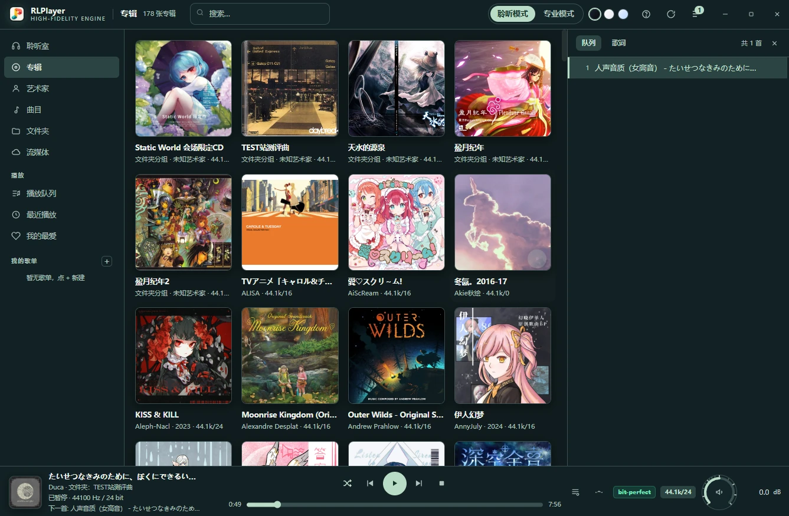
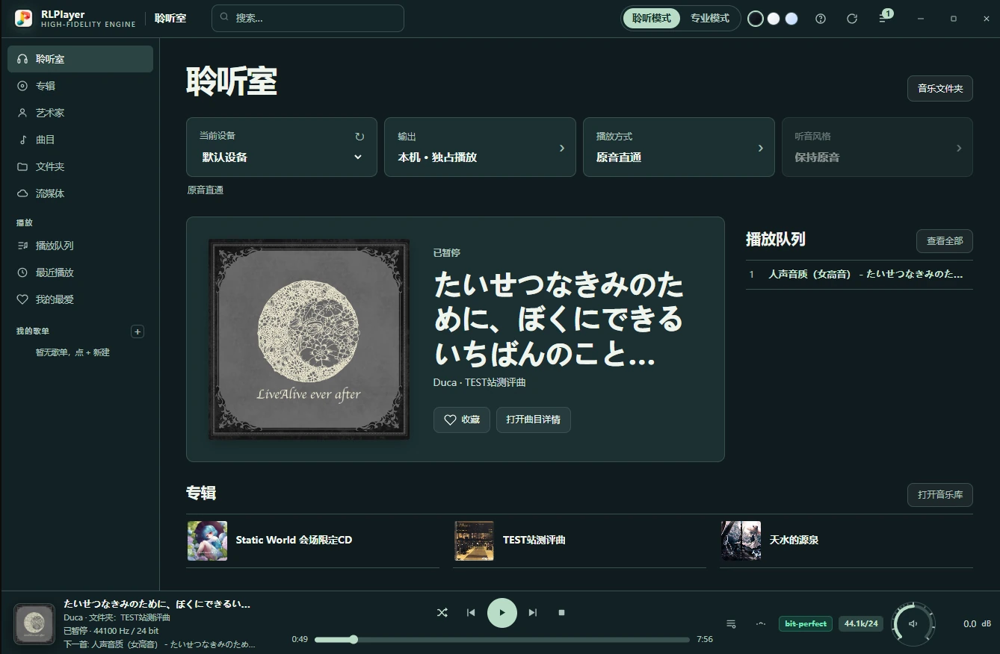
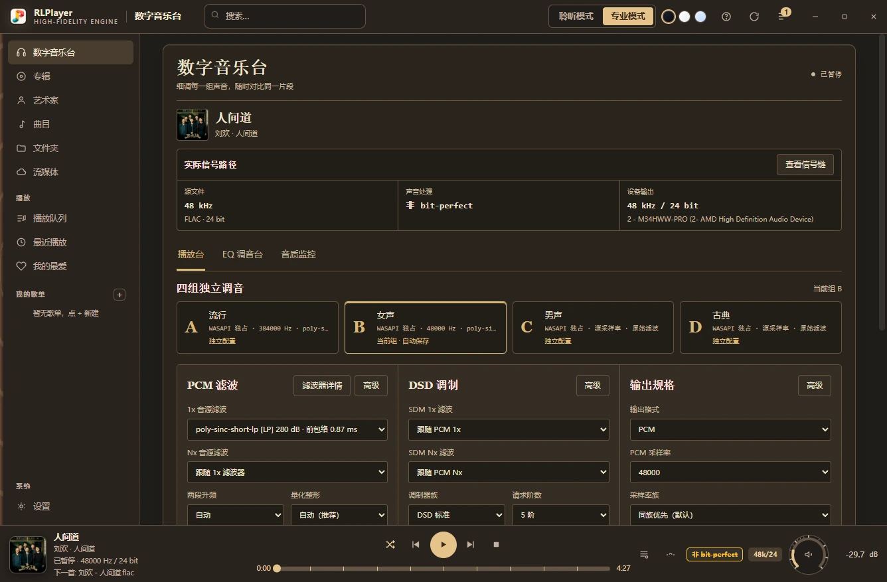

# RLPlayer 3.4.0

**免费、开源的 Windows 本地高保真音乐播放器。**

聆听模式把复杂设置收起来，让你专心选音乐；专业模式把输出、升频、滤波、DSD、均衡与实际信号路径放进数字音乐台。两种方式，共用同一套播放引擎。

[获取 Windows 正式发布版](https://github.com/okhuoyanyan/RLPlayer2/releases/tag/v3.4.0) · [官方网站](https://rlplayer.rainlain.com/) · [使用说明](https://rlplayer.rainlain.com/manual.html) · [技术细节](https://rlplayer.rainlain.com/features.html) · [实测数据](https://rlplayer.rainlain.com/measurements.html)

 

## 先听音乐，也能掌控每一环

### 聆听模式

以专辑、文件夹、歌单和艺术家浏览本地收藏。封面、歌词与音乐资料可以在线补全；温和、均衡、锐利三种听音风格，让首次使用无需逐项理解参数。



*图片直接复用新版官网现有素材，展示聆听模式的音乐库；这是官网界面展示图，不作为 3.4.0 新增功能的验收截图。*



### 专业模式

A—D 四组分别保存整套播放配置。不同音乐、耳机和 DAC，可以留下各自的输出、升频、滤波、调制与已保存均衡。



| 能力 | 具体内容 |
|---|---|
| PCM 滤波 | 79 个命名预设，1x / Nx 独立选择，参数详情与频响、群延迟、冲激图 |
| DSD 路径 | DoP 与 ASIO 原生 1-bit，PCM 转 DSD，最高 DSD1024；可用路径取决于驱动、设备与算力 |
| 数字音乐台 | A—D 配置组、每组输出后端与设备、实际信号路径、同曲片段对比 |
| 均衡与校准 | 20 段参数 EQ、16 套保存槽位、OPRA 耳机 EQ、房间校准 |
| 音频分析 | 波形、音质监控、版本对比与可查阅的测量数据 |
| 网络播放 | UPnP / DLNA 投放；实际接收格式以接收端能力和状态为准 |
| GPU | AMD HIP 与 NVIDIA CUDA；无适配设备时回退 CPU |
| 多语言 | 中文、英文、日文、法文、俄文、西班牙文、阿拉伯文 |

官网图片均复用现有素材，来源与 SHA256 见 [图片来源清单](docs/images/homepage/provenance.json)。

## 3.4.0 更新

- **抖动与噪声整形修正**：修复 `shaped` 实际落入无抖动分支的问题，恢复高通 TPDF；已有的 10 个手动名称保留，自动模式按实际输出采样率和有效位深选择。这里没有把已有名称当成新算法。
- **DAC 有效位深**：PCM 主卡增加独立设置，支持自动或 8—32 bit。它决定实际量化精度，与传输容器的 16 / 24 / 32 bit 分开；不等于声卡模拟端的实测精度。
- **耳机交叉馈送**：PCM 高级页增加轻度、标准与参数调节，默认关闭。它把左右声道的一部分交叉混合，用于调整耳机的声像体验。
- **ASIO 精度与曲尾**：修正单位增益的整数舍入、启停与收尾处理、Native DSD 状态，以及探测参数的解析。
- **响应与界面**：合并重叠状态请求，防止旧搜索、旧艺术家响应覆盖新页面；修复请求正文超时与变更请求丢回复后的自动重发。抖动、DAC 位深与帮助说明直接出现在 PCM 主卡。

自上一个 GitHub 版本 3.3.11 以来，还包含 PCM 转 ASIO 原生 DSD、滤波器详情、CD 播放/暂停与切换修复、统一加载 EQ，以及六种外语的界面翻译修正。

### 验证结果与适用范围

本次正式包对应 **779 个冻结源文件**。最终覆盖 293 项门禁，跳过 0、未解决失败 0；包含首次执行、针对修正的重跑与打包后复核，累计 451 次实际执行。23 项测试仍含部分未覆盖分支。

- ASIO 实际装箱验证：5,473,719 个样本、222 项断言。
- xDuoo 实机：PCM 1536 kHz 与 Native DSD1024 各使用约 −66 dBFS 的 4 秒素材，驱动格式回读正确、欠载 0、缓冲排空完成。
- 最终包真实 WebView2 窗口核验了抖动、PCM 主卡和交叉馈送。
- 自包含包的静态兼容检查、AMD 仅 System32 PATH 实卡运行、包内 FLAC / DSF 离线解码通过；CUDA 完成 19 架构与导出符号检查，本机没有 NVIDIA 实卡。

这些数字描述指定条件下的数字处理、驱动与缓冲行为，不代表 DAC 模拟回录、听感评分或与商业播放器专有算法等效。

## 下载与使用

系统：**Windows 10 / Windows 11，x64**。GPU 为可选加速；显卡和音频设备仍需各自的厂商驱动。解压后的程序与内置运行时约需 1 GB，缓存和音乐文件另计。

1. 从 [3.4.0 发布页](https://github.com/okhuoyanyan/RLPlayer2/releases/tag/v3.4.0) 下载 `RLPlayer-3.4.0-win64.zip`。
2. 解压到普通、可写目录，例如 `D:\RLPlayer`。
3. 双击 `RLPlayer.exe`，选择音乐文件夹与输出设备。
4. 在聆听模式选择一种听音风格，或进入专业模式配置数字音乐台。

正式发布版内置 FFmpeg / ffprobe、AMD HIP 运行时、GPU DLL、WebView2、ASIO 探测与命令行工具，无需另装 ROCm。

**已有用户升级前先备份程序目录与配置。** 程序内更新由自有服务器的签名清单决定；GitHub 仅提供手动完整包。本次完整包保留 WebView2 `157.0.4341.46`，没有跟随构建机自动升级运行时。

| 文件 | 字节数 | SHA256 |
|---|---:|---|
| `RLPlayer-3.4.0-win64.zip` | 423,950,581 | `a6bc93d637fc7a1f89a1ae50135b1bd0ed062e5c6ff37876e515d7013ef17cf5` |
| `RLPlayer-3.4.0-source.zip` | 20,625,059 | `c357e4f98212dc9abcb362b735c589267770e56e586ce97f89734012c6a9a59b` |

正式包与源码 ZIP 均保持已验收字节；发布页提供 `SHA256SUMS.txt`。源码 ZIP 为 779 个源文件加 3 个快照元数据文件。本仓库额外更新 README 与官网图片说明，生产代码与冻结清单逐项一致，见 [发布源码说明](docs/release-3.4.0-source.json)。

国内访问 GitHub 较慢时，可从 [官网获取下载入口](https://rlplayer.rainlain.com/download.html)。国内完整包分享由管理员维护。

## 已知边界

- **日志收尾延迟仍待定位**：曾观察到 Native 设备关闭后，结束状态仍等待收尾日志约 4.47 秒；Windows 具体慢 I/O 层尚未唯一定位，长曲 STAT 仍同步写日志。本轮以短段实机与 466 项离线收尾判据为回归基线。
- **硬件证据有范围**：本轮实机为上述两条 4 秒路径；没有新的模拟回录、主观听感、NVIDIA 实卡或所有设备长时稳定性结论。驱动缓冲逐次协商差异也未定位。
- **高阶整形有使用条件**：手动 NS9 / LNS15 在 PCM 有效位深低于 16 bit 时拒绝启用；高阶整形的超声噪声可能较高。名称相同不代表与 HQPlayer 的未知专有曲线一致。
- **CD 使用 Windows MCI 直通**：不经过本播放器的 DSP；没有可读 CD-Text 时显示 Track NN。
- **DSD 与其它能力**：纯 DSD 域异速率转换、实时多电平 AHM、D3D12 / oneAPI 后端，以及部分专用硬件校正尚未实现。
- **测量不是无限条件证明**：滤波器图表与证书需要结合输入、采样率与频率网格阅读；有限频点不构成连续全频带数学证明。软件侧样本一致也不证明 DAC 内部处理或模拟输出一致。

## 联网与反馈

本地播放和扫描无需账号。封面、歌词、音乐资料、AI、更新与主动反馈涉及外部服务，可在设置中管理。部分自动补全与预取会在启用对应功能后后台执行。

遇到问题，优先使用程序里的 **意见反馈**：提交前可预览脱敏诊断信息，不上传音乐文件。新反馈进入自有服务，不再自动创建公开 GitHub 工单。

- 官网：[rlplayer.rainlain.com](https://rlplayer.rainlain.com/)
- 粉丝和反馈 Q 群：**895816505**
- macOS 独立项目：[BH2VOQ/RLPlayer-Mac](https://github.com/BH2VOQ/RLPlayer-Mac)

## 开发与构建

这是 Windows 主线；macOS 项目独立维护。构建需要 Windows SDK、MSVC 工具链环境、Clang C++23、CMake、Ninja 与 Python。默认构建不会开启音频设备。

下面使用本版验证过的 ROCm Clang 路径；未安装该工具链时，需按实际 Clang 路径调整。命令在源码根目录的 PowerShell 中运行，Python 依赖只安装到当前目录。

```powershell
python -m pip install --target .source-audit-deps -r tools/requirements-audit.txt -i https://pypi.tuna.tsinghua.edu.cn/simple
$auditDeps = (Resolve-Path -LiteralPath '.source-audit-deps').Path
cmake -G Ninja -S . -B build-source -DCMAKE_BUILD_TYPE=Release -DCMAKE_CXX_COMPILER="C:/Program Files/AMD/ROCm/7.2/bin/clang++.exe" -DCMAKE_RC_COMPILER="C:/Program Files/AMD/ROCm/7.2/bin/llvm-rc.exe" "-DRTA_CERTIFICATE_PYTHON_PATH=$auditDeps"
cmake --build build-source --parallel 2
```

测试前阅读 [安全门禁脚本](tools/run_safe_ctest.ps1) 和 [测试清单](tools/safe_test_manifest.json)，准备完整 FFmpeg 夹具生成器、包内精简解码器与独立运行目录。硬件测试单独执行；不要直接在默认听音设备上播放测试音。

自包含出包还需要外部依赖与文档载荷，见 [打包脚本](tools/make_dist.ps1)、[HIP 构建](tools/build_gpu.ps1)、[CUDA 构建](tools/build_gpu_cuda.ps1)。源码快照附带的 `SOURCE_ARCHIVE_README.txt` 首行保留了历史基线名称；本版版本以 `src/version.h`、发布标签和冻结 SHA256 清单为准。

## 开发与致谢

项目开发：**RainLain、猫与小行星**。协助开发：聆听风暴。媒体与美术：Gosed。测试鸣谢：Miyu、正在下载99%，以及提交反馈和帮助验证的朋友。

## 许可

[GPL-3.0-or-later](LICENSE)。第三方组件各自遵循原许可，见 [THIRD-PARTY-NOTICES.txt](THIRD-PARTY-NOTICES.txt) 与 [OPRA-NOTICE.txt](OPRA-NOTICE.txt)。AMD、NVIDIA、Microsoft 等厂商组件不因随包分发而改用本项目许可。

RLPlayer 为独立开源项目，与商业播放器厂商无隶属关系。
